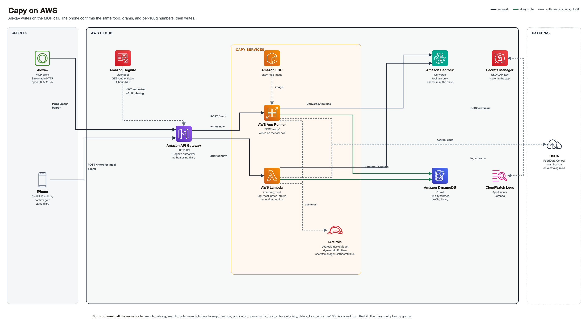

# Capy

iPhone meal log with a Python agent. Alexa+ and the phone write the same diary.

## Introduction

Capy records meals on iPhone. You describe what you ate. The agent looks up the food, converts the portion to grams, and writes one diary entry. Calories, protein, carbs, and fat come from that food’s `per100g` and are scaled by grams / 100.

Alexa+ says the meal over MCP. The phone confirms the same food, grams, and numbers, then the Food Log shows that line.

## Architecture

Amazon API Gateway is the front door. Amazon Cognito signs the bearer. A call with no bearer is a 401, and nothing is logged.

AWS App Runner runs the MCP server and writes the meal while you are talking. AWS Lambda runs `interpret_meal` for the phone and waits until you confirm. Both call the same tools. Amazon Bedrock is the model. It cannot mint the plate. Amazon DynamoDB stores the diary, profile, and library. AWS Secrets Manager holds the USDA key.



| Piece | Role |
| --- | --- |
| Alexa+ | MCP client. Streamable HTTP, spec 2025-11-25. `POST /mcp/` with a bearer. Writes on the tool call. |
| iPhone | SwiftUI Food Log. Confirms the food, the grams, and the per-100g numbers, then shows the same diary. |
| Amazon Cognito | User pool. `GET /authenticate` returns a one-hour JWT. Same email and password as the phone. |
| Amazon API Gateway | HTTP API. Cognito authorizer on every call. |
| Amazon ECR | Image for the MCP server, `capy-mcp`. |
| AWS App Runner | Runs that image. MCP at `POST /mcp/` (`functions/cloudrun/mcp/host.py`, mounted by `functions/cloudrun/app.py`). |
| AWS Lambda | `interpret_meal` for the phone (`functions/main.py`). Log, meal, and profile writes land after confirm. |
| Amazon Bedrock | Converse with tool use. A line lands only when the lookup returned it. |
| Amazon DynamoDB | Diary, profile, and library. Partition key is the user. Sort key is the day, the food, or the profile. |
| AWS Secrets Manager | USDA FoodData Central key. It stays out of the app. |
| Amazon CloudWatch Logs | Logs for App Runner and Lambda. |

The IAM role for those services can call Bedrock, pull the image, read and write DynamoDB, read the USDA secret, and write logs.

Both runtimes call the same tools: `search_catalog`, `search_usda`, `search_library`, `lookup_barcode`, `portion_to_grams`, `write_food_entry`, `get_diary`, `delete_food_entry`. `per100g` is copied from the hit. The diary multiplies by grams. USDA is the lookup when the catalog misses.

## What it does

- Food Log, Capy conversation, and Library on iPhone.
- Shared tools, plus profile and library edits. Arguments are in [docs/architecture/mcp-tools.md](docs/architecture/mcp-tools.md).
- `write_food_entry` logs one entry. A second food is a second call.
- On iPhone, the first write waits until you confirm the same food id, grams, and `per100g`. MCP writes on the call.
- `GET /authenticate` signs you in and returns a bearer plus an MCP client config. The token lasts one hour.

Logging one food is `search_catalog` (or USDA, library, or barcode), then `portion_to_grams` with that hit’s measures, then `write_food_entry` with `day_key`, `meal_slot`, `kind`, `name`, `grams`, `foodId`, `source`, and `per100g` copied from the hit. A later turn uses `get_diary` for that day, then `write_food_entry` again or `delete_food_entry`.

## How to run

Python 3.12. The seed catalog does not need API keys.

```bash
cd functions
python3.12 -m venv venv
source venv/bin/activate
pip install -r requirements.txt
uvicorn cloudrun.app:app --host 127.0.0.1 --port 8080
```

- Health: `GET http://127.0.0.1:8080/healthz`
- MCP: `POST http://127.0.0.1:8080/mcp/` with `Accept: application/json, text/event-stream` and `Authorization: Bearer <token>`. Keep the trailing slash. A request without a bearer returns `401`.

For the iPhone app, open `app/capy.xcodeproj`. The **capy Local** scheme uses `./run.sh` from the repo root. The **capy Prod** scheme uses the deployed API.

## Testing

Offline. These tests do not call Bedrock or USDA.

```bash
cd functions
./venv/bin/python -m pytest tests/test_jobs.py tests/test_tool_schema.py -q
```

## Repository

| Path | What it is |
| --- | --- |
| `app/` | iPhone app. Open `app/capy.xcodeproj`. |
| `functions/agent/` | Meal agent: graph, prompts, and the shared diary tools. |
| `functions/cloudrun/` | App Runner service. MCP at `/mcp/`, sign-in at `/authenticate`. |
| `functions/main.py` | Lambda entry the phone calls, including `interpret_meal`. |
| `assets/hackathon/capy-architecture.png` | AWS architecture diagram. |
| `docs/` | API contract, harness, MCP tools, screens, and the local runbook. |

## Contributing

See [CONTRIBUTING.md](CONTRIBUTING.md). The license is [MIT](LICENSE). Copyright 2026 Sagar Bansal.
