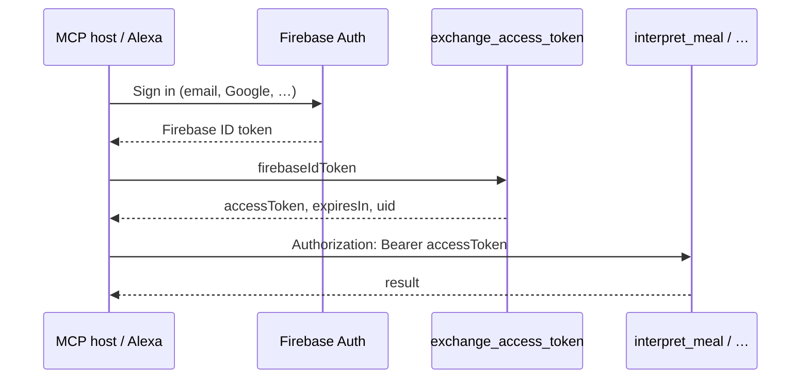

# External client auth (MCP, Alexa, HTTP)

iOS uses the Firebase SDK (`httpsCallable`), which attaches a **Firebase ID token** automatically. Other clients call the same **Callable HTTP** endpoints with `Authorization: Bearer <token>`.

## Supported bearer tokens

| Token | How to obtain | Lifetime | Use |
|-------|----------------|----------|-----|
| **Firebase ID token** | Firebase Auth REST/SDK after sign-in (email, Google, etc.) | ~1h (refresh via SDK) | Direct callable access |
| **Cappy access token** | `exchange_access_token` callable with a valid Firebase ID token | 1h (`expiresIn`: 3600) | MCP, scripts, Alexa skills |

Both map to the same Firebase **uid** for Firestore data (`users/{uid}/…`).

## Callable auth resolution

Every authenticated callable (`interpret_meal`, `log_meal`, `patch_profile`, `get_thread`, `patch_thread`):

1. **Firebase Callable context** — `req.auth.uid` when the Firebase client protocol validates the ID token (iOS SDK, or HTTP with Bearer ID token).
2. **Bearer fallback** — If `req.auth` is missing, read `Authorization: Bearer` from the raw HTTP request and verify:
   - Try `firebase_admin.auth.verify_id_token`
   - Else verify Cappy JWT (`iss=capy`, `aud=capy-api`, HS256 signed with `API_ACCESS_TOKEN_SECRET`)

Implementation: `functions/agent/auth.py` → `resolve_callable_uid`.

## Browser sign-in

`GET /kitchen` on `cappy-api` is a sign-in page. The user enters the same email and password as the iPhone app. `POST /kitchen/session` returns `{ accessToken, tokenType, expiresIn, mcpUrl }` and a config block for an MCP client (`url` + `Authorization: Bearer`). The token lasts 1 hour. The page does not store a session.

`FIREBASE_WEB_API_KEY` (the Firebase web API key) must be set on the service. It is not a Secret Manager value and is not committed.

The iPhone app mints the same token from Settings → MCP token, using the signed-in Firebase user.

## Exchange flow (scripts and Alexa linking)



### `exchange_access_token` (callable, no prior auth)

**Request** (`data`):

```json
{ "firebaseIdToken": "<Firebase ID token>" }
```

**Response**:

```json
{
  "accessToken": "<JWT>",
  "tokenType": "Bearer",
  "expiresIn": 3600,
  "uid": "firebase-uid"
}
```

Errors: `UNAUTHENTICATED` if the ID token is missing or invalid.

## HTTP callable wire format

Same as the iOS emulator client:

```http
POST https://{region}-{project}.cloudfunctions.net/{functionName}
Authorization: Bearer <ID token or access token>
Content-Type: application/json

{"data": { ...payload } }
```

Emulator:

```http
POST http://127.0.0.1:5001/{project}/{region}/{functionName}
```

## Secrets

| Secret | Purpose |
|--------|---------|
| `API_ACCESS_TOKEN_SECRET` | HMAC key for Cappy access JWTs (Secret Manager in prod; `functions/.secret.local` locally) |

Generate a local secret (example): `openssl rand -base64 32`

## MCP

| Mode | URL / transport |
|------|------------------|
| **Hosted (Cloud Run)** | `https://{service}-{project-number}.{region}.run.app/mcp/` — MCP Streamable HTTP (spec 2025-11-25), `POST` JSON-RPC; Bearer auth. Also `POST /exchange_access_token` on the same host. See [alexa-setup.md](alexa-setup.md). |

## Alexa

Account linking, callable URLs, and skill Lambda patterns: [alexa-setup.md](alexa-setup.md).

## Security notes

- Access tokens are **user-scoped** (uid in `sub`); treat like a session credential.
- Do not embed long-lived Firebase refresh tokens in MCP config; exchange to access tokens in a trusted bootstrap step.
- App Check is not enforced on callables yet (see [security.md](security.md)).
